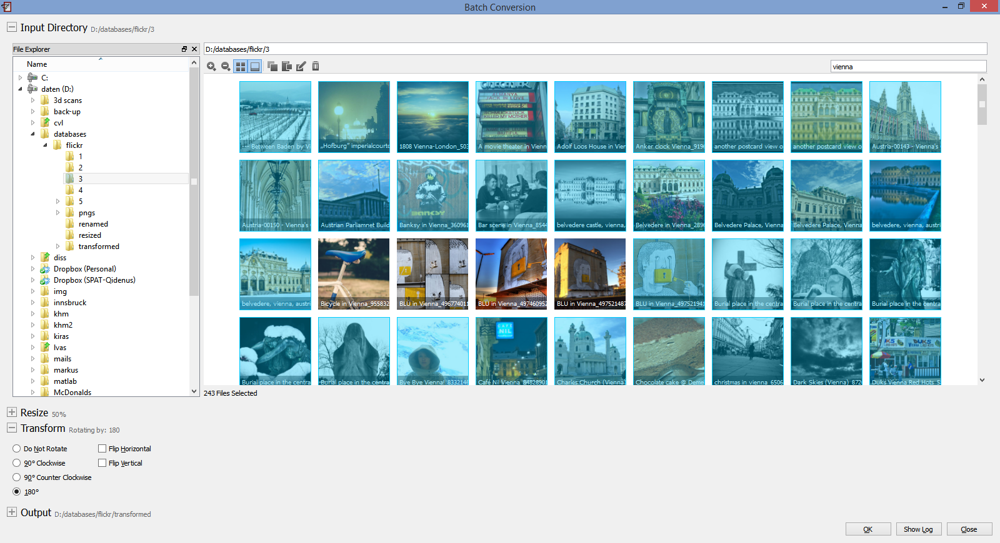
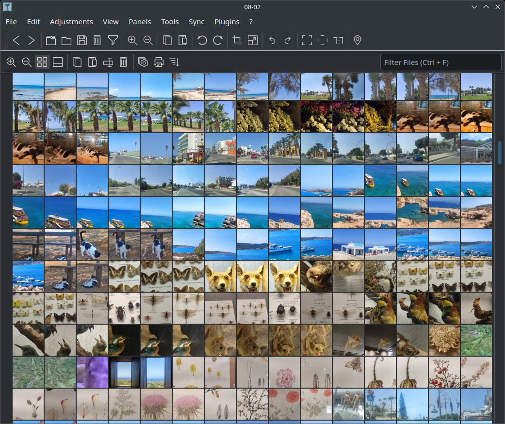

# nomacs for Comparing Images and Reviewing Details

nomacs Image Lounge is a desktop viewer for checking photographs, comparing processing stages, and preparing groups of images.
Use the nomacs image viewer to move between a broad view of the scene and the small regions that explain a visible difference.

[](https://nomacs-image-lounge.github.io/nomacs/)

## Compare the same detail in two viewers

Open the reference and its processed version in separate nomacs instances.
Connect the viewers through the Sync menu, then align their position and magnification before judging the result.
Synchronized movement makes it easier to compare a face, a textured surface, or a sharpened edge without repeatedly finding the same location.

Start a review folder from the terminal when the executable is available as `nomacs`:

```bash
nomacs --directory "./review-set"
```

The command opens images for interactive review; connect the comparison viewers through the application.
Keep filenames visible so you can tell the reference from the candidate.



Compare at a matching scale before deciding that one image contains more detail.
A fit-to-window view can conceal artifacts or make different image dimensions appear equivalent.
Use an overlay when alignment is close enough for transparency to reveal shifted edges.

The [official synchronization guide](https://nomacs.org/blog/synchronization/) describes linked movement, zoom, and overlays.
For an implementation comparison, qView separates image loading in [qvimagecore.h](src/qvimagecore.h) and [qvimagecore.cpp](src/qvimagecore.cpp) from viewport behavior in [qvgraphicsview.h](src/qvgraphicsview.h) and [qvgraphicsview.cpp](src/qvgraphicsview.cpp).

## Establish what the displayed image represents

A filename extension does not tell you the image dimensions, embedded metadata, or decoding path.
Check those details before comparing an original camera file with an exported JPEG.

- Review dimensions before choosing a meaningful zoom level.
- Distinguish file modification time from camera capture metadata.
- Inspect the histogram when evaluating clipped highlights or shadows.
- Check whether an apparent difference is caused by an edit or by display and decoding choices.
- For an animation, identify which frame is being examined.

The nomacs photo viewer can show information overlays and a histogram when supported by the build.
For animated formats, pausing selects a frame for inspection; saving a displayed frame creates a still image.

qView's information dialog is declared in [qvinfodialog.h](src/qvinfodialog.h), implemented in [qvinfodialog.cpp](src/qvinfodialog.cpp), and laid out in [qvinfodialog.ui](src/qvinfodialog.ui).
Its file-information presentation is useful to compare with the overlays used during a nomacs review.

## Turn selected images into consistent review copies

Use Tools > Batch Processing to collect the intended inputs and choose the output location.
For review copies, a separate output directory keeps it clear which files belong to the original capture.

1. Select a small representative group containing portrait and landscape images.
2. Set the output format and inspect the filename preview.
3. Choose a long-side resize value when both orientations need the same maximum dimension.
4. Enable Shrink Only when small images should retain their original size.
5. Process the sample and reopen the results before using the same choices on the full set.



Renaming changes a name; format conversion changes the encoding.
Include a sequence component when a naming pattern would otherwise produce collisions.

For an existing saved batch preset, the native command-line interface can run the job and record its log:

```bash
nomacs --batch "./review-copy.pnm" \
  --batch-log "./review-copy-log.txt"
```

The preset must already describe the intended inputs and processing choices; the [native command-line manual](https://github.com/nomacs/nomacs/blob/master/ImageLounge/xgd-data/nomacs.1) documents the batch options.
Read the log and inspect sample outputs after the job.
The [batch-processing guide](https://nomacs.org/blog/batch-processing/) explains the interactive selection, resizing, conversion, and output controls.

For comparison with a single-file workflow, qView's rename dialog appears in [qvrenamedialog.h](src/qvrenamedialog.h) and [qvrenamedialog.cpp](src/qvrenamedialog.cpp).
External application handoff is described by [openwith.h](src/openwith.h) and implemented in [openwith.cpp](src/openwith.cpp).

## Make navigation repeatable during a review

Choose a folder order that matches the question: capture sequence, matching filenames, or another consistent ordering.
Keep zoom behavior predictable when alternating between candidates.
A slideshow is useful for an overall sequence, while a stationary view is better for inspecting one troublesome detail.

When comparing viewer behavior, qView's INI-backed settings can express a simple unfiltered, unscaled reference presentation:

```ini
[options]
bgcolorenabled=true
filteringenabled=false
scalingenabled=false
```

This fragment uses qView keys defined in [settingsmanager.cpp](src/settingsmanager.cpp) and its setting types in [settingsmanager.h](src/settingsmanager.h).
It describes settings for a platform using the INI backend; choose the desired zoom explicitly during the comparison.

qView's key-binding representation is in [shortcutmanager.h](src/shortcutmanager.h), with handling in [shortcutmanager.cpp](src/shortcutmanager.cpp).
The shortcut editor layout is supplied as [qvshortcutdialog.ui](src/qvshortcutdialog.ui).
Its options interface uses [qvoptionsdialog.h](src/qvoptionsdialog.h) and [qvoptionsdialog.cpp](src/qvoptionsdialog.cpp).

For everyday nomacs work, set controls through its own preferences and confirm the active bindings in the menus.
Use the same background and viewing scale when the goal is to judge image changes rather than interface differences.

## Check format support in the actual application build

Common raster formats, camera RAW data, and specialized image containers can follow different decoding paths.
Support depends on the libraries and image plugins included with the installed package.

| Format or operation | Dependency to check |
| --- | --- |
| Camera RAW | LibRaw and the relevant nomacs build options |
| HEIC, AVIF, or JPEG XL | Matching Qt image-format plugins and packaged codecs |
| Multipage TIFF | TIFF support in the nomacs build |
| Images inside ZIP files | Quazip support enabled for that build |
| Additional editing tools | Available nomacs plugins and their dependencies |

Test a representative file from the camera or exporting application you actually use.
A format listed by the project does not guarantee that every package includes the same optional libraries.
Keep the nomacs plugins version compatible with the application and its dependencies.

The [official repository README](https://github.com/nomacs/nomacs/blob/master/README.md) documents optional build features and runtime image-format support.
Use those requirements when investigating a file that opens on one computer but fails on another.

## Follow a viewing issue back to a specific behavior

For a reproducible report, record the application version, platform, image format, zoom level, and the smallest sequence of actions that demonstrates the issue.
Describe whether it happens while opening, navigating, resizing the window, or handing the file to another program.

For readers investigating the supplied qView code, [main.cpp](src/main.cpp) registers the file argument and starts the application.
The [qvapplication.h](src/qvapplication.h) declaration shows how application-wide managers are connected.
The action lifetime check in [tst_actionmanagertests.cpp](tests/tst_actionmanagertests.cpp) exercises cloned window actions.
The accompanying [CMakeLists.txt](tests/CMakeLists.txt) defines the test build, and [LICENSE](LICENSE) contains the supplied source license.

## Related Search Terms

nomacs image lounge, nomacs image viewer, nomacs photo viewer, nomacs source code, nomacs plugins, image-viewer, photo-viewer, picture-viewer, cross-platform, qt, cpp, raw-image, avif, jpeg-xl, nomacs
